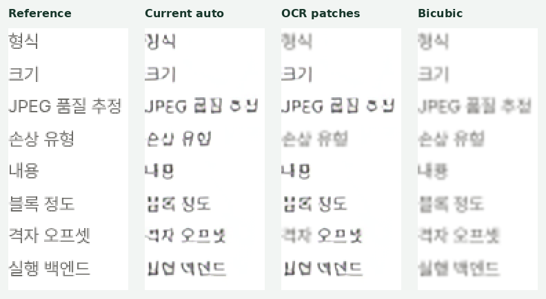
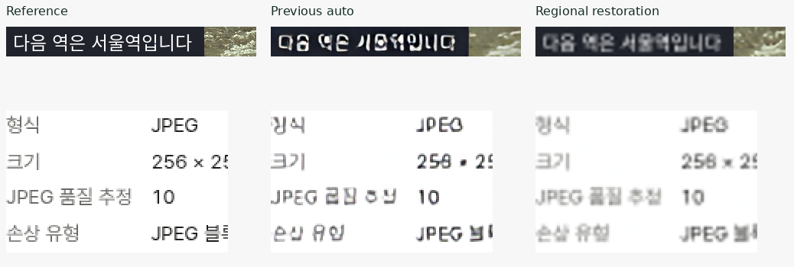

# 화질구지 개선기 (Hwajilguji Restorer)

"화질구지" is Korean internet slang for an image that looks bad because it was saved, shared, and re-saved many times with lossy compression. Each save adds blocks, smears, and colour banding. This tool reduces that damage and can enlarge the image afterwards.

Everything runs in your browser. Your image never leaves your computer. There is no server.

## How it works

The app inspects the image first, then picks a repair path for the damage it finds.

1. **Gate.** Plain image analysis (OpenCV) reads the file header and the pixels. It decides whether the image has JPEG blocks, smeared detail, a reduced colour palette, or no visible damage. It also decides whether the content is a photo or a graphic with text.
2. **Model.** A small pretrained neural network (ONNX Runtime Web, WebGPU with a WebAssembly fallback) repairs the image. JPEG blocks and smeared detail (WebP, AVIF, HEIC) go to a JPEG deblocking model. Palette images (GIF) are smoothed and go to a general upscaling model. Photos use scale-specific SPAN weights at 2x and 4x. Graphics use the graphic upscaler.
3. **Finish.** A light OpenCV pass restores the large-scale colour of the source and smooths leftover banding in flat areas. For automatic 2x and 4x, PP-OCRv3 locates text on the original image. The app adjusts the detected regions according to scale and damage, then shows the fraction of the image they cover.
4. **Upscale.** You can keep the size (1x), double it (2x, the default), or quadruple it (4x). Every model runs on small tiles, so large images do not exhaust memory.

At 2x and 4x, **자동 복원** applies the repair path above. **확대만** skips damage repair and enlarges the input directly, keeping colour matching and alpha. For text and graphics, its upscaler reduces the 4x prediction back to input size, measures the RGB difference from the input, then upsamples and adds that correction once. You can select **글자·그림** if a screenshot is detected as a photo. The damage override applies in automatic repair mode.

## Supported formats

Input:

- JPEG
- WebP (lossy)
- AVIF
- HEIC / HEIF
- GIF (first frame only)
- PNG (for a damaged image that was saved again as PNG)
- JPEG XL, only if your browser can decode it natively

Output: PNG only. Saving as JPEG or WebP again would add the damage this tool removes.

## Limits

- Animated GIF and animated WebP: only the first frame is processed.
- Size caps: an input image may have at most 8,000,000 pixels. An output image may have at most 32,000,000 pixels. The app disables a scale that would go over the output cap.
- No published model repairs JPEG, WebP, AVIF, HEIC, and GIF damage together. JPEG blocks have a dedicated model. WebP, AVIF, and HEIC reuse that model, which was not trained for them. GIF uses a general-purpose upscaling model. The table below lists what this project measured.
- The browser must be able to decode the format. If it cannot, the app says so.
- Without WebGPU the app falls back to single-thread WebAssembly. It still works, but it is slower.
- The JPEG deblocking model needs the WebGPU `shader-f16` feature. On a GPU without it, that model runs on WebAssembly while the upscaling models still use the GPU.

### Measured quality

The evaluation ran at 1x on the first 8 of 24 Kodak images, on a CPU. The gain is the PSNR of the output minus the PSNR of the damaged input, both against the clean original. A positive gain means the app improved the image. The evaluation does not run the colour-match finish step.

| Damage | Setting | PSNR gain (dB) | SSIM, input to output |
|---|---|---|---|
| JPEG | quality 10 | +2.70 | 0.745 to 0.816 |
| JPEG | quality 20 | +2.61 | 0.828 to 0.879 |
| JPEG | quality 30 | +2.62 | 0.865 to 0.907 |
| JPEG | quality 40 | +2.62 | 0.886 to 0.922 |
| JPEG | quality 90 | +1.98 | 0.967 to 0.977 |
| JPEG, three saves | quality 30 | +2.58 | 0.864 to 0.906 |
| WebP | quality 10, 30, 50 | +0.62, +0.84, +0.94 | 0.814 to 0.826, 0.882 to 0.892, 0.914 to 0.923 |
| AVIF | quality 20, 40 | +0.45, +0.72 | 0.775 to 0.787, 0.875 to 0.886 |
| HEIC | quality 20, 40 | +0.42, +0.78 | 0.791 to 0.803, 0.931 to 0.937 |
| GIF | 256 colours, dithered | -2.93 | 0.938 to 0.899 |
| GIF | 64 colours, no dither | -2.60 | 0.940 to 0.885 |

WebP, AVIF, and HEIC go through the JPEG deblocking model and gain PSNR in every measured case. Before that change they went through the general upscaler and lost 0.6 to 3.3 dB. The app's finish step lowers the gain a little. On 2 of the 8 images, run through the app's own routing code with the ONNX Runtime WebAssembly backend, the app route gained 0.33 to 0.57 dB, and the deblocking model alone gained 0.39 to 0.64 dB. GIF still loses PSNR at 1x, because it goes through a bilateral filter and the general upscaler, and the app does not promise a gain for GIF. PSNR does not measure sharpness.

The damage gate names the right damage class for 31 of 32 test fixtures (96.9%) and 359 of 384 corpus images (93.5%). On the corpus, 16 smeared images read as blocky, 7 blocky images read as smeared, and 2 clean images read as blocky. Both numbers come from running `inspect` on the images: the fixtures that `web/tests/gate.test.ts` reads (the test requires at least 90%), and every image that `hwajilguji-tools corpus` writes plus the 24 originals. Use the damage override in the page when the gate is wrong.

### Korean OCR comparison tool

The local `text-regions` tool takes the original input and a 2x or 4x PNG saved from the app. It compares Tesseract's Korean word boxes on the restored image and a bicubic enlargement. A word with at least two Hangul syllables needs confidence 75 and a 15-point lead over the existing pixels in its box. The tool blends the bicubic pixels at those boxes and preserves the restored alpha channel.

Install the Tesseract executable and its Korean language data to run it. Use `--tessdata-dir` if the data lives outside Tesseract's search path.

```sh
uv run --frozen --project tools hwajilguji-tools text-regions source.png restored.png text.png
```

We checked 190 reference characters across two screen crops (settings and a document) and three rendered samples (chat, receipt and subtitles). Each sample was box-downsampled at both scales. The table counts insertions, deletions and substitutions on transcribed lines, ignoring spaces and punctuation. Tesseract read all five originals without errors. The same recognizer supplied the word boxes and scored the lines.

| Output | 2x errors | 4x errors |
|---|---:|---:|
| Previous automatic restoration | 56 | 199 |
| Automatic restoration with text regions patched | 45 | 197 |
| Bicubic alone | 26 | 168 |

The 2x settings crop below is displayed at twice its output pixel size. On these eight labels, OCR made 21 character errors on the previous output, 17 after patching and 13 on bicubic.



The tool selected no regions on 32 inputs from eight Kodak photos enlarged at both scales, with and without JPEG compression. The small gain at 4x and the lower error count from bicubic alone are reasons to keep this as a local experiment.

### Photo model selection benchmark

We used the centre 256×192 pixels of Kodak images 04–11, box-downsampled by 2 or 4. Each input was saved losslessly or as a quality 25 JPEG with 4:2:0 chroma subsampling. We compared the app's PNG output in Chrome on single-threaded WebAssembly. Each cell is the mean RGB PSNR in dB across eight images, including their borders.

| Input | Previous automatic | SPAN automatic | Swin2SR direct | Swin2SR automatic |
|---|---:|---:|---:|---:|
| Lossless 2x | 27.76 | 29.44 | — | — |
| Lossless 4x | 23.91 | 25.63 | — | — |
| JPEG 2x | 24.77 | 26.60 | — | — |
| JPEG 4x | 21.54 | 23.36 | 23.00 | 22.85 |

The automatic routes used the same damage gate, deblocker and finish step. We swapped the photo model for the 48-channel SPAN checkpoint at the requested scale or the Swin2SR compressed 4x checkpoint. The direct Swin2SR route skipped deblocking and used the clean finish. For JPEG 4x, mean SSIM was 0.554 with the previous route, 0.575 with SPAN, 0.553 with Swin2SR direct and 0.542 with Swin2SR automatic. The Swin2SR export accepted one fixed 96×80 padded tile in this experiment. The SPAN exports had dynamic tile sizes and were 1.70 MB at 2x and 1.76 MB at 4x. [Per-image results](docs/upscale-comparison.csv) · [SPAN weights](https://github.com/hongyuanyu/SPAN) · [Swin2SR weights](https://github.com/mv-lab/swin2sr/releases/tag/v0.0.1)

### Automatic restoration on photos with text

Automatic 2x and 4x use native SPAN on photos. Text detection runs separately on the input, including captions within photos and documents classified as graphics. PP-OCRv3 returns a probability map. For 2x photos with block or smear damage, the general Real-ESRGAN model processes only tiles that intersect the detected text. Its pixels are blended into the SPAN output inside the mask before colour matching. Other text regions use cubic interpolation of the input with feathered edges after colour matching. All models run locally. The OCR comparison command above is an evaluation tool.

We compared PNGs downloaded from the previous automatic mode (`ed0c74c`) and the regional restoration pipeline at `1f81860` in Chrome with single-threaded WASM. RGB PSNR and SSIM include image borders. Kodak 04–11 provided eight 256×192 crops, each tested at two scales and with or without JPEG quality 25. On five Korean screens (190 characters per scale), Tesseract read fixed transcribed lines. Counts include insertions, deletions and substitutions. The detector and the scoring recognizer are different models.

| Test | Previous | Current | Bicubic |
|---|---:|---:|---:|
| Lossless photos 2x / 4x, PSNR dB | 27.76 / 23.91 | 29.45 / 25.63 | 29.04 / 24.95 |
| JPEG photos 2x / 4x, PSNR dB | 24.77 / 21.54 | 26.58 / 23.36 | 25.20 / 22.48 |
| Korean screens 2x, character errors | 56 | 25 | 26 |
| Korean screens 4x, character errors | 199 | 162 | 168 |

Three 448×224 crops from Kodak 12–14 carried Korean captions (27 reference characters). At 4x, lossless caption errors fell from 18 to 5 and quality 25 JPEG errors fell from 27 to 24. At 2x, JPEG errors stayed at 1. We also placed letters directly over three other photos (Kodak 15–17, 25 characters), downsampled with Lanczos and encoded at quality 35. At 2x, errors went from 3 to 1 on WebP and from 2 to 3 on AVIF. At 4x they went from 25 to 23 and from 31 to 24 respectively. These comparisons informed the routing choice. The five Korean screens still have substantial errors at 4x. Their mean SSIM fell from 0.936 to 0.907 at 2x and from 0.816 to 0.803 at 4x. [Scores for all 72 input and scale combinations](docs/restoration-quality.csv)

After fixing the model routes, we evaluated four further Kodak photos (18–21). We used 384×200 centre crops, Lanczos downsampling, and quality 40 JPEG. Plain-photo PSNR rose from 24.27 to 25.69 dB at 2x and from 21.77 to 22.46 dB at 4x. On the same crops with four new Korean captions (31 characters), OCR errors stayed at 3 at 2x and went from 30 to 31 at 4x. These 16 additional conditions support a photo quality gain. They do not establish a general improvement for small photo captions. [Held-out scores](docs/restoration-holdout.csv)



In one desktop Chrome run on single-threaded WASM, we timed the interval from starting repair to the PNG link appearing. The median of four warm runs on a lossless Kodak 07 crop fell from 1.40 to 0.61 seconds at 2x and from 0.48 to 0.22 seconds at 4x. On the Kodak 12 JPEG with a caption, 2x went from 3.87 to 4.65 seconds with both photo models active. At 4x it went from 1.09 to 0.64 seconds. Each scale used its own downsampled input of the same reference. A separate 3000×2000 to 6000×4000 run completed in about 9 seconds on a laptop RTX 3060 in desktop Chrome and about four minutes on single-threaded WASM. Chrome reported 22 distinct tile progress values during the GPU run. On a captioned JPEG the same GPU used WASM for deblocking, and the maximum output RGB difference from WASM was 3 levels out of 255.

### Compression halos around lettering

Automatic 2x and 4x restoration also checks the background around detected text. For images with block or smear damage, or JPEGs below the existing quality threshold, it samples nearby flat colours and moves small deviations toward the dominant background. The pass skips conflicting background colours and limits correction near strong strokes. It runs inside the current text mask, before the original alpha plane is reattached.

We compared browser PNGs against the preceding version (`1f81860`). The primary measure is mean absolute RGB error on known background pixels within two low-resolution pixels of the original lettering. Each input has equal weight. We froze six design scenes and six additional scenes, tested both scales, and measured two separately captured app headings after JPEG compression. The caption text was also scored with Korean Tesseract.

| Samples | 2x ring RGB error | 4x ring RGB error |
|---|---:|---:|
| Six separately evaluated scenes | 16.29 to 10.29 | 20.91 to 19.21 |
| Two Chrome captures from this app | 11.92 to 6.96 | 27.95 to 24.37 |

The held-out lines contain 52 characters per scale. Character errors went from 0 to 2 at 2x and from 42 to 39 at 4x. RGB error around the glyphs measures the compression fringe. OCR measures how much of the wording can be recovered. [Image report](docs/text-halo-report.pdf) · [Per-image measurements](docs/text-halo-quality.csv).

## Run locally

Prerequisites: Node 26.13.1, pnpm 12.21.0, and uv 0.13.9 or newer (uv installs Python 3.14.10). The `corpus` and `export` commands download the Kodak images and the model weights, so they need network access. An NVIDIA GPU speeds up the Python evaluation but is not required. The Python tools run only through uv.

```sh
pnpm install --frozen-lockfile
pnpm exec lefthook run pre-commit --all-files        # lint, type check, unit tests

pnpm --dir web dev                                   # development server
pnpm --dir web build && pnpm --dir web preview       # production build, served locally

pnpm --dir web exec playwright install chromium
pnpm --dir web e2e                                   # browser test on a real QF 10 JPEG

uv run --project tools hwajilguji-tools corpus       # degrade the Kodak images
uv run --project tools hwajilguji-tools export       # build the ONNX models
uv run --project tools hwajilguji-tools evaluate     # PSNR and SSIM table
uv run --project tools hwajilguji-tools fixtures     # test fixtures for the web app
```

The full specification is in [`docs/spec.md`](docs/spec.md).

## Deploy on Render

The app is a static site, so it needs no server. `render.yaml` describes the site as a Render Blueprint. In the Render Dashboard, click **New > Blueprint** and select this repository. Render builds with the Node version in `.node-version` and the pnpm version in `package.json`, then publishes `web/build`. Each commit to the linked branch triggers a deploy.

## Third-party models and licenses

| Role | File | Source | License |
|---|---|---|---|
| JPEG deblocker | `dejpeg-v2.onnx` | [`Miosp/dejpeg`](https://github.com/Miosp/dejpeg) release `v2.0.0` | Apache-2.0 |
| Photo upscaler for 1x palette repair and damaged 2x text regions | `realesr-general-x4v3.onnx` | Exported from the official `realesr-general-x4v3.pth` of [`xinntao/Real-ESRGAN`](https://github.com/xinntao/Real-ESRGAN) | BSD-3-Clause |
| Photo upscalers, 2x and 4x | `span-x2.onnx`, `span-x4.onnx` | [SPAN](https://github.com/hongyuanyu/SPAN) | Apache-2.0 |
| Text detector | `ppocr-text-mask.onnx` | [OpenCV Zoo PP-OCRv3](https://huggingface.co/opencv/text_detection_ppocr) | Apache-2.0 |
| Upscaler, graphic (automatic repair) | `realesr-animevideov3.onnx` | Exported from the official `realesr-animevideov3.pth` of `xinntao/Real-ESRGAN` | BSD-3-Clause |
| Upscaler, graphic (확대만) | `realesr-animevideov3-backprojection.onnx` | Same pretrained weights with one back-projection step | BSD-3-Clause |

The license texts ship in `web/static/models/NOTICE.md`.

Other notable dependencies:

- **OpenCV.js** (`@techstark/opencv-js`, Apache-2.0) for image analysis and filters.
- **ONNX Runtime Web** (`onnxruntime-web`, MIT) for model inference.
- **heic-to** (LGPL-3.0) decodes HEIC files. The app loads it only when you open a HEIC or HEIF file. HEVC, the codec inside HEIC, is covered by patent pools. If that matters for your use, do not open HEIC files.

This repository has no project `LICENSE` file yet. The team has not chosen one.
